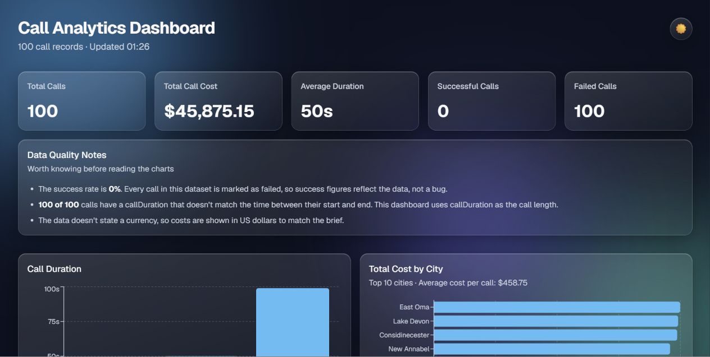
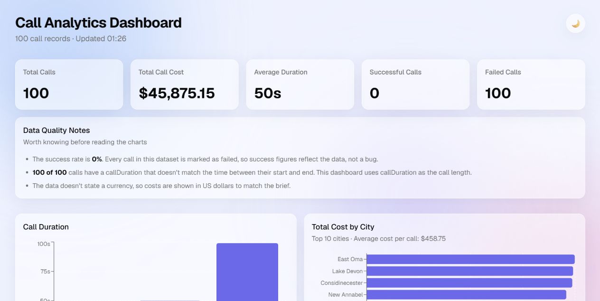

# Call Analytics Dashboard

A dashboard that analyses telecom Call Data Records (CDR) from an API, built for Week 2 of my Software Development Internship with London Success Academy.

**Live demo:** [call-analytics-dashboard-rho.vercel.app/](https://call-analytics-dashboard-rho.vercel.app/)




## Features

- KPI cards: total calls, total cost, average duration, successful and failed calls
- Charts: call duration, cost by city, call activity by hour, calls by city
- Call log table, newest first
- Light and dark glass theme, remembered per browser tab
- Data quality notes that flag issues in the source data
- Loading, error and empty states
- Responsive layout for desktop and mobile

## Tech Stack

React (Vite) · TailwindCSS · shadcn/ui · Recharts · Vercel

## Run Locally

```bash
npm install
npm run dev
```

## Data Notes

- Every call in the provided dataset is marked as failed, so the success rate is 0%.
- Some calls have a `callDuration` that doesn't match their start and end times. The dashboard uses